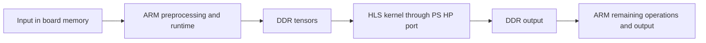

# Zybo HLS

Develop and measure inference on the original Zybo using its Cortex-A9 processor
and programmable logic. Start by testing RF-DETR Nano as a deployment candidate.
Select hardware acceleration only after establishing a working software path
and measuring the bottlenecks. A compact CNN remains an alternative if Nano
cannot meet the memory, runtime or latency requirements.

## Board and toolchain

| Item | Recorded configuration |
| --- | --- |
| Board | Original ZYBO, not Z7-20 |
| FPGA target | `xc7z010clg400-1` |
| Processor | Dual Cortex-A9, ARMv7, 32-bit |
| External memory | 512 MB DDR3 |
| Programmable logic | 80 DSP slices; Digilent lists 240 KB block RAM |
| Existing tools | Vivado, Vitis and HLS 2026.1 |
| Previously verified flow | HLS C simulation, RTL co-simulation, implementation and a standalone Vitis board application |

Board specifications: [Digilent ZYBO reference manual](https://digilent.com/reference/_media/reference/programmable-logic/zybo/zybo_rm.pdf).
Previous application success does not establish Linux or neural-network runtime
support. Keep new builds isolated and use a matching bitstream, XSA and ELF.

## RF-DETR Nano feasibility

Nano is the smallest detector variant configured in the inspected RF-DETR
1.12.0 installation. Its defaults include a DINOv2 windowed small backbone,
384 x 384 input, hidden width 256, 300 queries and two decoder layers.
The named Small variant is larger: its defaults include 512 x 512 input and
three decoder layers.

A local Nano checkpoint inspection found approximately 30.5 million model-state
values occupying 121.9 MB in FP32. This is not the exported inference footprint:
training-specific state may be removed, while inference adds activations,
runtime allocations and buffers. The complete checkpoint also contains optimizer
state and must not be used as the deployed-model size.

The weight capacity alone therefore does not rule Nano out on 512 MB DDR.
Eight-bit storage could reduce eligible weight storage, but mixed precision,
operator compatibility and execution speed need measurement. Reducing input
resolution reduces computation and activation memory much more than weight size.
The inspected Nano resolution override requires multiples of 32; 224 or 256
are candidate runtime experiments after export correctness is checked.

Use three decision gates:

1. **Export and inspect.** Export the inference graph at batch size one. Record
   actual weights, tensor shapes, operators and precision. Compare outputs with
   the original implementation at 384 and a supported lower resolution. Define
   acceptable stored-image latency before deciding whether performance is useful.
2. **Run the complete model on ARM.** Investigate a Linux ARM32 C/C++ runtime,
   confirm every required operator, then measure initialization and steady-state
   peak memory, latency and output correctness without relying on swap. ONNX
   Runtime documents ARM32v7 targets, but this specific board/model combination
   remains unverified. This route needs additional Linux/runtime work beyond
   the existing standalone Vitis application.
3. **Choose HLS from the profile.** Measure the time and transferred bytes for
   candidate matrix/linear operations. Estimate total speedup including the
   unaccelerated layers and transfer costs. Continue only if the achievable
   improvement justifies the integration work.

Allow two or three initial investigation sessions, then record whether to
continue, switch model family or defer an unresolved runtime issue. A time-budget
decision does not prove the model is technically impossible. Full-board
inference means all model layers execute on the Zybo; a laptop feeding an
accelerated block is only a development harness.

References: [RF-DETR export documentation](https://rfdetr.roboflow.com/latest/exports/),
[ONNX Runtime build documentation](https://onnxruntime.ai/docs/build/inferencing.html).
Pin compatible versions during implementation; current documentation may differ
from the installed RF-DETR version.

## Hardware partition and memory transfers

For Nano, investigate a reusable matrix/linear kernel after profiling. Attention,
normalization and sampling operations may limit the benefit of accelerating only
matrix multiplication. For a compact CNN alternative, investigate a reusable
Conv3x3/Conv1x1 kernel. Neither choice requires the complete model to reside in
on-chip RAM: use tiling and local buffers with external DDR.

Use AXI-Lite for control registers and addresses, with `m_axi` bulk transfers
through a Zynq PS high-performance port. An AXI DMA/stream design is an alternative.
Verify alignment, burst accesses, physical addresses and cache coherency. Under
Linux, use an appropriate driver/DMA buffer mechanism; standalone cache APIs
and ordinary process pointers cannot simply be reused.

The previous ANN application measured a mean 253,390 timer ticks for a full FPGA
transaction versus 14,345 for its CPU reference. Input/weight loading consumed
228,430 ticks, about 90% of the transaction. This is evidence from a different
application, but it motivates replacing AXI-Lite tensor transfers with bulk
access and measuring the complete pipeline.

Start with modest parallelism. Use pipeline directives, buffer reuse and tiling,
then increase parallel multiply-accumulate units only when synthesis, bandwidth
and routed timing justify it. Avoid assuming a GPU-oriented model's advertised
latency predicts FPGA or Cortex-A9 performance.

## Conversion and numerical contract

Current hls4ml documentation lists CNN support through PyTorch and ONNX, but no
multihead-attention support through those frontends. Experimental support through
other paths does not establish RF-DETR conversion. Vitis versions newer than
2024.1 are described as less tested. Keep hls4ml optional and validate a small
example before depending on it. [hls4ml support matrix](https://fastmachinelearning.org/hls4ml/intro/status.html)

For each exported kernel, record input/output shapes, tensor layout, precision,
scales, bias representation, accumulator width, rounding and overflow/saturation
behaviour. Also record any padding, stride and activation rules. Maintain a
software reference with exactly the same numerical contract.

Check representative activation tensors, zeros, extreme values, padding
boundaries and repeated calls through C simulation, RTL co-simulation and board
execution. Use exact integer equality where applicable and explicit tolerances
for floating operations. Keep implementation correctness separate from the
quality effects of changing precision or resolution.

## Measurements and completion

Compare ARM-only and ARM+FPGA using the same model, numerical representation,
inputs and output rules. Report:

- Initialization and steady-state peak memory.
- Kernel time, transfer/cache overhead and complete input-to-output latency.
- Median, p95, maximum observed latency, sample count and throughput.
- DSP, LUT, register and BRAM use, achieved clock and routed timing.
- Compiler flags, warm-up, image-I/O timing boundaries and matching artifact IDs.

Correct complete-board inference is the first milestone. Acceleration additionally
requires an improvement in total measured latency. Synthesis estimates alone
do not establish board performance or a real-time bound.

For a periodic application, define bounded buffers, ready/running/result/error
states and an explicit policy for inputs arriving too quickly. Choose the input
period from measurements; maximum observed latency is not a proven worst-case
execution time.
